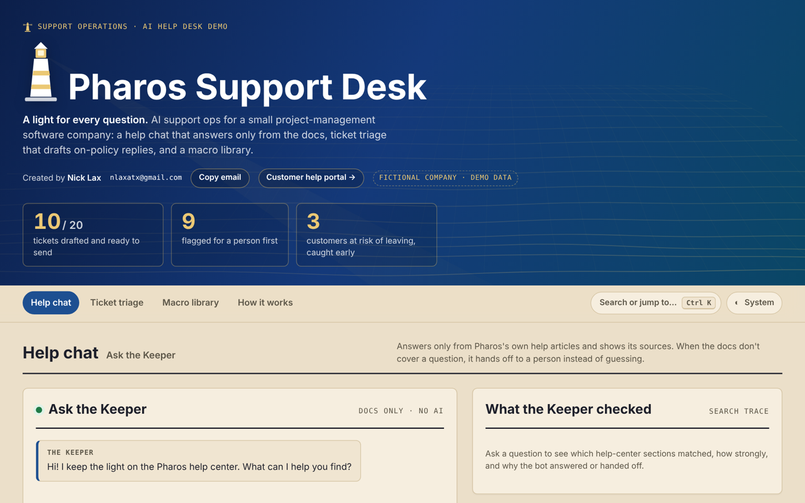
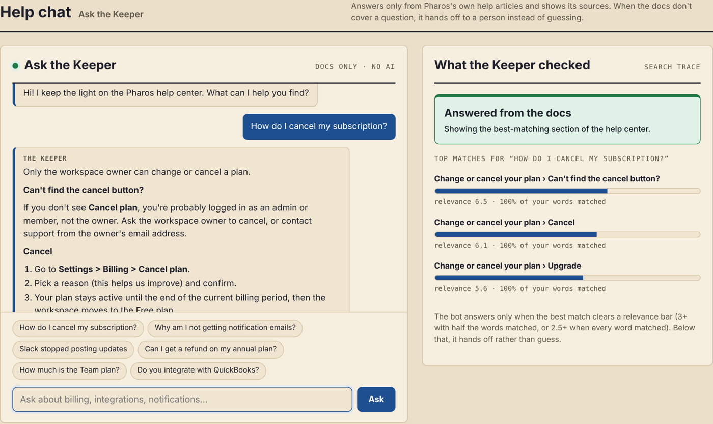
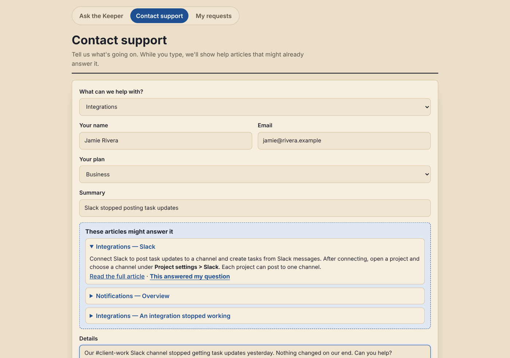
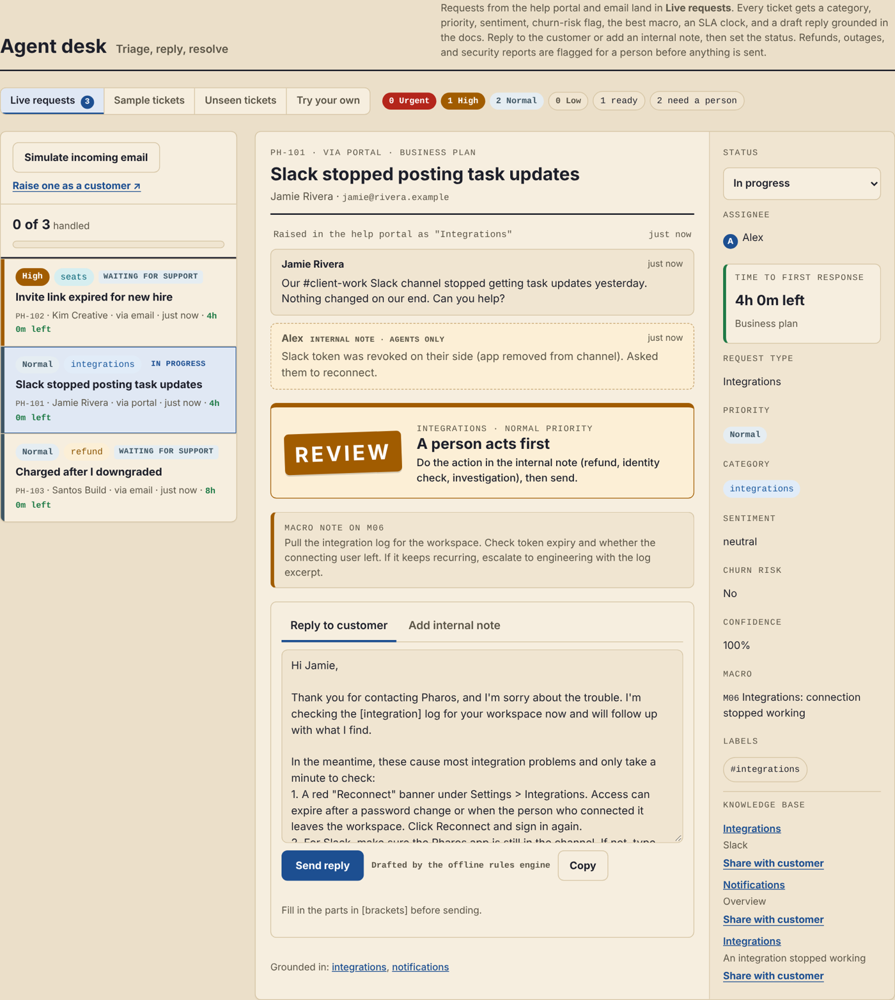
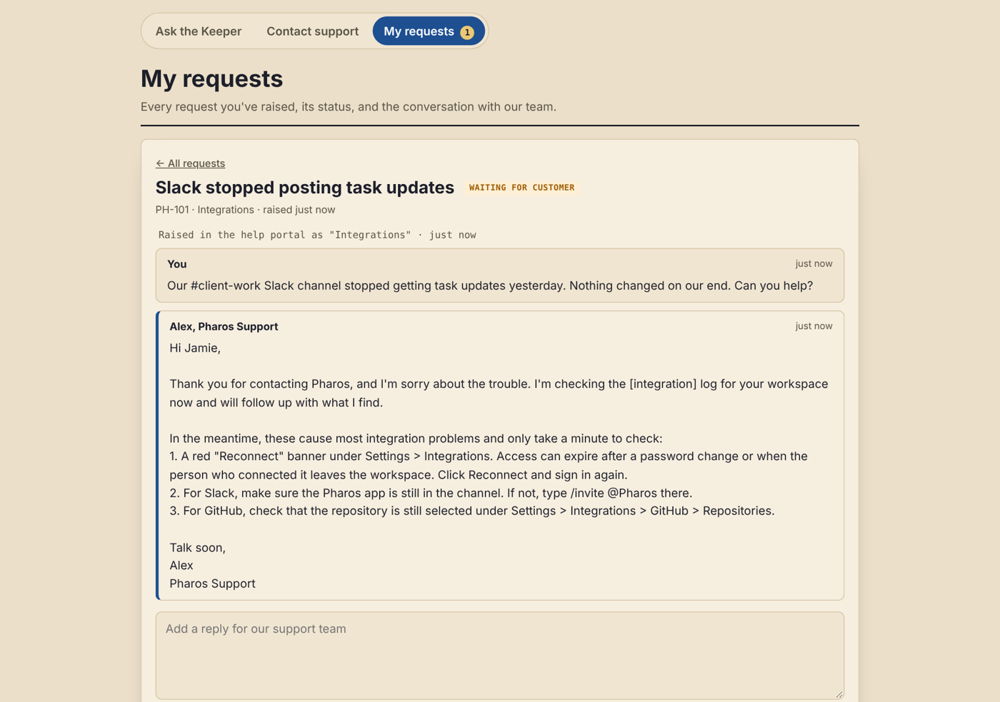
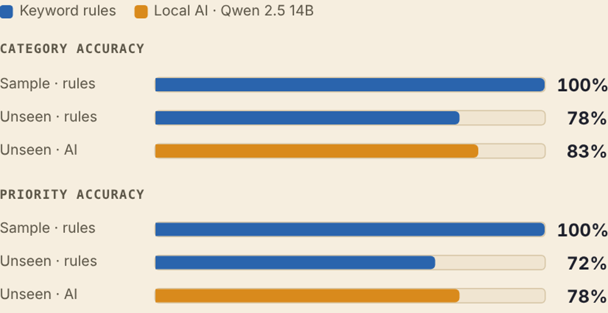
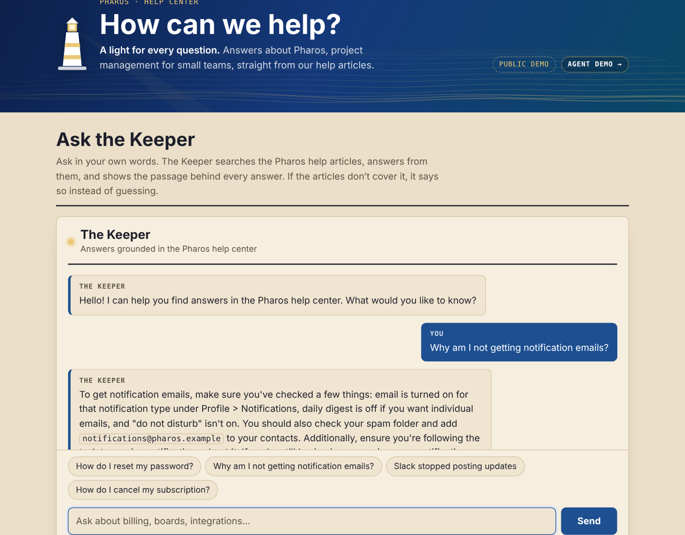

# Pharos Support Desk

**AI support operations for a small software company, modeled on Jira Service Management: a customer help portal with a docs-grounded chatbot, an agent desk where requests are triaged, drafted, and answered, and a macro library, with every result measured against hand-labeled tickets.**

*Created by Nick Lax · nlaxatx@gmail.com*

**[Live demo](https://scenebiscuit-cell.github.io/support-desk-repo-1/)** · **[Customer help portal](https://scenebiscuit-cell.github.io/support-desk-repo-1/portal/)** · **Walkthrough video:** *coming soon*



## The problem

Small support teams lose hours every week to the same three things: sorting the inbox, rewriting the same replies, and answering questions that are already in the help center. AI can help with all three, but only if it doesn't make things up, doesn't promise refunds it can't give, and keeps a person in charge of anything risky.

Pharos is a fictional project-management app for small teams. I built its support operation the way I'd build one for a real client: from the help articles and policies outward, and measured before trusting.

## What I built

| | What it does | Guardrail |
|---|---|---|
| **Help-center chatbot ("the Keeper")** | Searches 12 help articles and answers from them, citing the source | Answers only when the docs clearly cover the question; otherwise hands off to a person instead of guessing |
| **Customer help portal** | Customers ask the Keeper first; if it can't help, they raise a request, see suggested articles while they type, and follow replies under **My requests** | Warns visitors not to share passwords or payment details |
| **Agent desk** | Requests from the portal and email land in a live queue. Each opens like a Jira issue: conversation, reply pre-drafted from the right macro, internal notes, status, assignee, an SLA clock, and help articles to share | Refunds, outages, and security reports are always flagged for a person; drafts are never auto-sent |
| **Ticket triage** | Tags each ticket with category, priority, sentiment, and churn risk and picks the best macro, with rules or AI | Every result is scored against hand labels |
| **Macro library** | 23 on-policy replies with tags, status actions, and internal notes; exports to CSV for any helpdesk | One consistent policy answer, whoever is on shift |



*The chat shows which help-center sections matched, how strongly, and why it answered or handed off.*

## How it works

1. **Search.** Help articles are split into sections and ranked with BM25 keyword search, plus synonyms and phrases ("can't log in" → login). It's fast, free, and explainable.
2. **Confidence gate.** The bot only answers when the best match clears a relevance bar. Below it, the question goes to a person.
3. **Triage, two layers.** A rules engine gives an instant, free baseline. An AI layer (Llama 3.3 70B on Cloudflare Workers AI, a local model through Ollama, or Claude) reads the ticket with the matching help sections and candidate macros, and returns structured JSON. If the AI fails or returns bad JSON, that ticket falls back to the rules.
4. **Voice guard.** AI drafts are cleaned up server-side before an agent sees them: stock phrases like "I understand your frustration" are removed, every draft opens with "Thank you for contacting Pharos," and it ends with one consistent sign-off.
5. **Cost and abuse limits.** The live AI runs on a small Cloudflare Worker that only serves this site, keeps the prompts server-side, caps input size, and limits each visitor to 10 AI answers a day (40 for the whole demo). That keeps it on Cloudflare's free tier.

## A request, end to end

1. **The customer asks the Keeper.** If the help center doesn't cover it, the Keeper says so and offers **Contact support**.
2. **They raise a request.** While they type, matching help articles appear. "This answered my question" closes the loop without a ticket (deflection).

   

3. **It lands in the agent desk** as **PH-101** in *Live requests*, already triaged, with an SLA clock based on the customer's plan (Business: 4 business hours, Team: 1 business day, Free: 2 business days; outages and security around the clock). Emails to support@ arrive the same way. In the demo, *Simulate incoming email* plays that part.
4. **The agent works it like a Jira Service Management issue:** read the conversation, add an internal note, share a help article, edit the pre-drafted reply (or redraft it with AI), and send. The status moves to *Waiting for customer*.

   

5. **The customer sees the reply under My requests**, never the internal notes, and can answer back (which puts it back in the queue) or mark it resolved.

   

The portal and the agent desk share requests through the visitor's own browser, so anyone can play both sides of the conversation in two tabs, and nothing leaves their machine. In production, the same store would live on the server (Cloudflare KV or D1), and a support address would feed it through Cloudflare Email Routing and a small Worker.

## Results

Every ticket has a hand label (correct category and priority), so accuracy is scored, not eyeballed. The **unseen** tickets were written and labeled after the rules were finished, and the rules were never tuned on them.

| Test set | Engine | Tickets | Routed to the right category | Right priority |
|---|---|---|---|---|
| Sample (rules written alongside these) | Keyword rules | 20 | **100%** (20/20) | 100% |
| **Unseen** | Keyword rules | **36** | 78% (28/36) | 72% (26/36) |
| **Unseen** | **AI: Qwen 2.5 14B, running locally** | **36** | **83%** (30/36) | **78%** (28/36) |



**What the misses taught me.**
- **The AI reads intent the rules can't.** It recognized "Billed for wrong plan" and "Charged for 14 seats, we only have 9" as refund requests, and knew that reusing a board *named* "Refund Requests" is a setup question, not a refund.
- **It isn't strictly better.** It turned "Everything is read-only" (an expired card) into an outage, a ticket the rules got right.
- **Both missed the same two security reports** ("someone logged into my account from another country"), reading them as ordinary login problems. That's the case for a deterministic safety net that sits in front of any model: some routing decisions are too important to leave to a score.

The AI run used a 14-billion-parameter open model on a home GPU, so ticket data never left the machine. Per-ticket results are in `output/holdout-ai/`.



## What I'd do next

- **Add a security safety net:** route any mention of an unrecognized login straight to security, whatever the rules or the AI say. Both missed it.
- **Score the larger cloud model** (Llama 3.3 70B on the Worker) on the same 36 tickets, and track priority over- vs. under-calls separately.
- **Use embeddings** for search once a help center grows past a few dozen articles.
- **Real email intake:** Cloudflare Email Routing → a Worker that turns each message into a request, with tickets stored server-side instead of in the browser.
- **Connect a real helpdesk** (Jira Service Management, Zendesk, or Help Scout) so tags, macros, and drafts land where agents already work.
- **Track deflection:** what share of chat questions got answered without a ticket, and how many handoffs turned out to be covered by the docs.

---

# Running it

Everything is Python standard library. Nothing to `pip install`.

## Quick start (Windows, Mac, or Linux, Python 3.10+)

```bash
cd support-ops-demo

python triage.py --eval          # triage the 20 sample tickets with the offline rules engine
python chat.py                   # chat with the help center (type 'quit' to exit)
python export_macros.py          # regenerate macros.csv and macros.md
python build_demo.py             # rebuild demo/index.html
```

Results land in `output/`: `triage_report.md` (the readable one), `triage_results.csv`, `triage_results.json`.

## Three ways to run

| Backend | Command | Cost | Notes |
|---|---|---|---|
| Offline rules | `--backend rules` (default) | Free | Keyword rules + macro fill-in. Instant. Good baseline, brittle on new phrasing. |
| Local model | `--backend ollama` | Free | Runs on your own GPU through Ollama. Ticket data never leaves the machine. |
| Claude API | `--backend anthropic` | Pennies per ticket | Best drafts. Needs an API key. |

**Ollama (local):**

```bash
ollama pull llama3.1:8b          # or qwen2.5:7b, which is good at structured JSON
python triage.py --backend ollama --eval
python triage.py --backend ollama --model qwen2.5:7b --eval
python chat.py --backend ollama
```

An 8B model fits in 8 GB of VRAM. Set `OLLAMA_HOST` if Ollama runs on another machine on your network (e.g. `http://192.168.1.50:11434`).

**Claude API:**

```powershell
# PowerShell
$env:ANTHROPIC_API_KEY = "sk-ant-..."
python triage.py --backend anthropic --eval
```

Set `ANTHROPIC_MODEL` to change the model.

If a model returns bad JSON or times out, that ticket falls back to the rules engine and the run keeps going. The report marks which tickets fell back.

## Measuring it

Every ticket set has hand labels, so accuracy is scored rather than eyeballed.

```bash
python triage.py --eval                                                    # sample set
python triage.py --eval --tickets data/holdout_tickets.json --labels data/holdout_labels.json --out output/holdout
node tests/parity.js           # the web page's triage matches the Python engine exactly
node tests/worker_voice.mjs    # the Worker's draft cleanup
python -m http.server 8000 & node tests/e2e_desk.js   # portal -> agent desk -> portal, end to end (needs Playwright)
```

See **Results** above for the current numbers. To score an AI backend on the unseen set, add `--backend ollama` (or `anthropic`) to the second command.

## The demo page

`demo/index.html` is self-contained. Open it in a browser, or share the published version.

- **Help chat** shows which doc sections matched, how strongly, and why the bot answered or handed off.
- **Agent desk** has four queues: **Live requests** (from the help portal and simulated email), the 20 **sample** and 36 **unseen** test tickets, and **Try your own** for any pasted ticket. Every ticket opens as an issue view with the conversation, reply and internal-note tabs, status, assignee, SLA, and knowledge-base suggestions.
- **Macro library** is searchable and copyable.
- **AI mode**: on the live site, "AI answer" and "Draft with AI" use the Cloudflare Worker. With Ollama running locally, local-AI buttons appear too. Without either, the page runs on the offline engine, so it always works.

To show AI-written drafts in the queue, run triage with a model, then rebuild:

```bash
python triage.py --backend ollama
python build_demo.py --results output/triage_results.json
```

## Live AI for every visitor (free, Cloudflare)

Both pages call a small Cloudflare Worker that runs Llama 3.3 70B on Cloudflare's free Workers AI allowance, with per-visitor and daily limits so it stays free. The Worker for this repo is live at `https://pharos-ai-worker.scenebiscuit.workers.dev`, and `.github/workflows/deploy-worker.yml` redeploys it whenever anything in `worker/` changes on `main`. See **`worker/README.md`** for details.

`build_demo.py` regenerates `worker/worker.js` with the Keeper and triage instructions built in. The Worker also cleans up AI drafts before they reach the page: it removes stock phrases ("I understand your frustration", "rest assured"…), opens with "Thank you for contacting Pharos.", and signs off as Alex. To point the pages at a different Worker:

```bash
python build_demo.py --cloud-url https://pharos-ai.YOUR-SUBDOMAIN.workers.dev
```

## Public help portal

`portal/index.html` is the customer-facing help page, published at `/portal/`. It has only the help chat and a short explanation of how answers are grounded in the help center; it never includes ticket, triage, or macro data. When the Worker is configured, the portal sends the question and the matching article excerpts to `/chat`; if the Worker is unavailable, it shows the matching help-center passage instead. `python build_demo.py` regenerates it from `portal/template.html`.

## Live local AI on the demo page

When you open the demo page on a computer running Ollama, a **Local AI** toggle appears in the chat, and a **Draft with local AI** button appears on each ticket. Everything runs on that computer's GPU. Visitors without Ollama see the normal page.

One-time setup on Windows so Ollama accepts requests from the page:

1. Quit Ollama (right-click its icon in the system tray, then Quit).
2. Open Start, search "environment variables", and choose **Edit environment variables for your account**.
3. Click **New**. Name: `OLLAMA_ORIGINS`. Value: your GitHub Pages address, like `https://yourname.github.io` (no trailing slash). Click OK.
4. Start Ollama again.

Then open your GitHub Pages link in Chrome or Edge. If the browser asks to allow access to devices on your local network, click Allow.

## Adapting it for a client

1. Replace `docs/*.md` with their help articles (keep the small front-matter block and `## ` section headings).
2. Rewrite `macros/macros.json` with their policies and voice. Run `export_macros.py` for a CSV they can import or review.
3. Put 20–50 of their real past tickets in `data/tickets.json` and label them in `data/labels.json`. Hold back a few as an unseen set.
4. Edit categories and keywords in `support_ops/taxonomy.py`.
5. Run `--eval` with each backend and show them the numbers.

## Project layout

```
docs/                    12 help-center articles (Markdown)
data/tickets.json        20 sample tickets        data/labels.json          their hand labels
data/holdout_tickets.json 36 unseen tickets       data/holdout_labels.json  their hand labels
macros/                  macros.json (source), macros.csv, macros.md
support_ops/kb.py        doc chunking + BM25 search
support_ops/llm.py       Ollama / Anthropic backends (stdlib HTTP)
support_ops/taxonomy.py  categories, priorities, keyword rules
support_ops/macros.py    macro selection, placeholder fill, exports
support_ops/triage_engine.py  rules + LLM triage, prompt, scoring
triage.py  chat.py  export_macros.py  build_demo.py
demo/template.html → demo/index.html and index.html (the GitHub Pages home page)
portal/template.html → portal/index.html (public help portal: Ask the Keeper, Contact support, My requests)
shared/desk-store.js     the shared request store, inlined into both pages by build_demo.py
DESIGN.md, PRODUCT.md     design system and product notes
assets/                   favicon and home-screen icons (lighthouse)
screenshots/              images used in this README (hero.png is also the link-preview image)
tests/                   parity, Worker voice, and end-to-end desk tests
worker/                  Cloudflare Worker for free live AI: worker.template.js → worker.js, wrangler.toml, README.md
.github/workflows/        deploys the Worker when worker/ changes
output/                  generated reports
```

## Known limits

- Search is keyword-based (BM25 with synonyms), not embeddings. It's fast and free and works well for a help center this size; a client with hundreds of articles may want embeddings.
- The chatbot's handoff thresholds were tuned on a handful of questions. Re-check them against real customer questions.
- Drafts are for an agent to review, never to auto-send. The design keeps refunds, identity checks, and security reports with people.
- Pharos, its customers, and all domains (`*.example`) are fictional.
